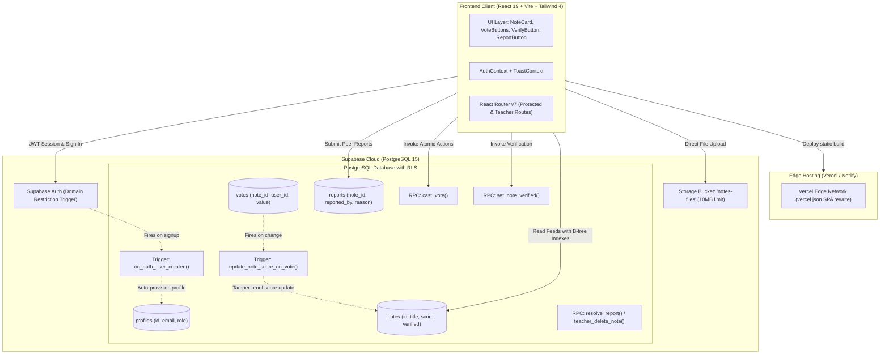

# Notes Hub 📚
### Collaborative Academic Notes Platform with Peer Voting & Faculty Verification

[](https://react.dev)
[](https://vite.dev)
[](https://tailwindcss.com)
[](https://supabase.com)
[](https://vercel.com)
[](https://opensource.org/licenses/MIT)

---

## 1. Problem Statement

In universities, study notes and exam preparation materials are scattered across unstructured WhatsApp groups, Discord servers, and personal Google Drive folders. This fragmentation leads to major academic bottlenecks:
- **Zero Quality Assurance**: Notes frequently contain calculation errors, missing proofs, or outdated syllabus topics.
- **Wasted Revision Time**: Students have no objective signal indicating which study guides are reliable, leading to poor exam performance.
- **Faculty Disconnect**: Professors lack a unified channel to review, endorse, or correct student-created study materials.

---

## 2. The Solution

**Notes Hub** is a centralized, peer-reviewed study portal that unites students and faculty. Students upload notes for their semester subjects, peers vote on clarity and completeness, and teachers verify curriculum accuracy.

### 🌟 Dynamic 3-Tier Ranking Algorithm
The platform ranks study materials using an objective database-driven hierarchy:
```
1. Teacher-Verified Status (Verified First)
   ↓
2. Net Voting Score (Upvotes minus Downvotes)
   ↓
3. Recency (Newest First)
   ↓
4. Primary Key Tie-Breaker (Stable Order)
```
> **Key Principle**: Faculty verification always supersedes peer popularity. A verified note with 4 votes will consistently rank above an unverified note with 24 votes, guaranteeing students study accurate material first.

---

## 3. Key Features

- **College Domain Authentication**: Restricts registration exclusively to students and faculty with valid institutional emails (e.g. `@msrit.edu`), enforced at both UI and database trigger levels.
- **Role-Based Access Control (RBAC)**: Distinct permissions for `student` and `teacher` roles.
- **Tamper-Proof Voting**: Upvote (+1) and Downvote (-1) actions with toggle-off and direction switching. Note authors are barred from upvoting their own materials. Net score is recalculated automatically via a PostgreSQL `SECURITY DEFINER` trigger.
- **Faculty Verification Badge**: Verified notes display a green verified badge with the endorsing professor's name and timestamp.
- **Teacher Review Queue (`/review`)**: Dedicated moderation dashboard showing unverified notes and community-reported materials requiring faculty intervention.
- **Peer Moderation & Reporting**: Students can report inaccurate, incomplete, or duplicate notes. Notes with negative scores (score ≤ -3) or multiple reports automatically surface in the review queue.
- **Multi-Filter & Search**: Real-time filtering by subject and semester with bookmarkable URL query parameter synchronization (`useSearchParams`).
- **Flexible File Storage**: Upload PDFs or images directly (up to 10 MB) via Supabase Storage, or link external Google Drive / cloud documents.
- **Zero Running Cost**: Built entirely on free-tier infrastructure (Vercel Hobby + Supabase Free).

---

## 4. Architecture Overview



---

## 5. Technology Stack

| Layer | Technology | Purpose |
|---|---|---|
| **Frontend Framework** | React 19.3 (JavaScript) | Component UI with hooks & optimistic state |
| **Bundler & Tooling** | Vite 8.3 + Rolldown | Sub-second HMR & vendor code-splitting |
| **Styling** | Tailwind CSS 4.3 | Responsive UI with modern CSS utility styling |
| **Routing** | React Router 7.18 | Declarative routing with protected/faculty guards |
| **Testing** | Vitest 5.1 | Unit testing for pure domain & ranking logic |
| **Linting** | Oxlint | High-speed static code quality analysis |
| **Backend & DB** | Supabase (PostgreSQL 15) | Relational database with Row Level Security (RLS) |
| **Authentication** | Supabase Auth | College email JWT session management |
| **File Storage** | Supabase Storage | Public bucket `notes-files` with folder RLS |
| **Hosting** | Vercel (Hobby Tier) | Global CDN deployment with SPA fallback |

---

## 6. Project Structure

```
├── .github/workflows/
│   └── keep-alive.yml         # GitHub Actions cron ping (prevents Supabase pause)
├── public/
│   ├── _redirects             # Netlify SPA routing fallback
│   ├── favicon.svg            # Custom SVG favicon
│   └── icons.svg              # SVG asset icons
├── src/
│   ├── components/            # Reusable UI components
│   │   ├── ErrorBoundary.jsx  # Global React catch-all error fallback
│   │   ├── Navbar.jsx         # Header with role badges & mobile toggle
│   │   ├── NoteCard.jsx       # Notes display with verified badge & file link
│   │   ├── ProtectedRoute.jsx # Route guard requiring authenticated user
│   │   ├── ReportButton.jsx   # Reporting modal with validation
│   │   ├── TeacherRoute.jsx   # Route guard requiring teacher role
│   │   ├── Toast.jsx          # Notification container
│   │   ├── VerifyButton.jsx   # Teacher verification button
│   │   └── VoteButtons.jsx    # Upvote/downvote arrows with optimistic state
│   ├── context/
│   │   ├── AuthContext.jsx    # Session management & user profile state
│   │   ├── authContextDef.js  # Context definitions (Oxlint safe)
│   │   └── ToastContext.jsx   # Global toast dispatch system
│   ├── hooks/
│   │   └── useAuth.js         # Custom auth hook
│   ├── lib/
│   │   ├── helpers.js         # Pure helper & ranking utilities
│   │   └── supabaseClient.js  # Initialized Supabase JS client
│   ├── pages/
│   │   ├── Home.jsx           # Main feed with sort/filter & pagination
│   │   ├── Login.jsx          # College domain email sign-up / sign-in
│   │   ├── NotFound.jsx       # 404 error page with Home redirect
│   │   ├── Review.jsx         # Faculty moderation dashboard
│   │   └── Upload.jsx         # File upload & Drive link form
│   ├── test/
│   │   └── pureLogic.test.js  # Vitest unit test suite (9 tests)
│   ├── App.jsx                # Router configuration & providers
│   ├── index.css              # Tailwind imports
│   └── main.jsx               # React DOM entry point
├── supabase/
│   ├── schema.sql             # Base database schema & tables
│   ├── phase2.sql             # Auth domain constraint trigger
│   ├── phase3.sql             # Storage bucket policies & notes RLS
│   ├── phase4.sql             # Tamper-proof voting trigger & cast_vote RPC
│   ├── phase5.sql             # Faculty verification & set_note_verified RPC
│   ├── phase6.sql             # Composite indexes for multi-tier ranking
│   ├── phase7.sql             # Peer reporting & moderation RPCs
│   └── seed-demo.sql          # Sample study notes across 5 semesters
├── .env.example               # Environment variables template
├── DEPLOY.md                  # Complete deployment guide (Vercel & Supabase)
├── DEMO.md                    # 3-4 min presentation script & Judge Q&A
├── SETUP.md                   # Local setup instructions
├── TESTING.md                 # Verification test suite documentation
├── vercel.json                # Vercel SPA routing rewrite
└── vite.config.js             # Vite configuration with code splitting
```

---

## 7. Local Setup Guide

### 1. Clone & Install
```bash
git clone https://github.com/<your-username>/notes-hub.git
cd notes-hub
npm install
```

### 2. Configure Environment
Copy `.env.example` to `.env`:
```bash
cp .env.example .env
```
Populate `.env` with your Supabase credentials:
```env
VITE_SUPABASE_URL=https://your-project.supabase.co
VITE_SUPABASE_ANON_KEY=your-anon-key-here
VITE_ALLOWED_EMAIL_DOMAIN=msrit.edu
```

### 3. Initialize Supabase Database
Run the SQL migration scripts in your Supabase SQL Editor in numerical order:
1. `supabase/schema.sql` (Tables & base indexes)
2. `supabase/phase2.sql` (Domain restriction trigger)
3. `supabase/phase3.sql` (Storage bucket & notes RLS)
4. `supabase/phase4.sql` (Voting trigger & RPC)
5. `supabase/phase5.sql` (Teacher verification RPC)
6. `supabase/phase6.sql` (Ranking indexes)
7. `supabase/phase7.sql` (Reporting & review queue)

### 4. Start Development Server
```bash
npm run dev
```
Open `http://localhost:5173` in your browser.

---

## 8. Presentation & Pitch Materials

### 📝 One-Paragraph Project Abstract
> *"Notes Hub is a collaborative, open-access study platform engineered to solve academic material fragmentation and misinformation in higher education. Restricting registration to verified college email domains, the platform empowers students to upload and peer-review subject notes while enabling faculty members to inspect and verify curriculum accuracy. Notes are ranked through an objective three-tier hierarchy—faculty-verified first, followed by net peer voting score, and chronological recency. Built entirely on free-tier infrastructure using React 19, Tailwind CSS, and Supabase PostgreSQL with Row Level Security and tamper-proof database triggers, Notes Hub establishes a transparent, trustworthy academic repository that saves study time and elevates exam readiness."*

---

### 📊 6-Slide Presentation Outline

#### Slide 1: The Problem
- **Title**: *Academic Notes are Broken*
- **Bullet Points**:
  - Study materials are scattered across informal WhatsApp chats, uncurated Drive links, and personal drives.
  - No objective signal for quality: students revise from incomplete, incorrect, or outdated notes.
  - Faculty members have no structured way to endorse or curate student contributions.

#### Slide 2: The Solution & Ranking Paradigm
- **Title**: *Notes Hub: Peer Collaboration Meets Faculty Authority*
- **Bullet Points**:
  - Centralized academic repository organized by semester and subject.
  - **Dynamic 3-Tier Ranking**: Faculty-verified notes rank first, followed by net community score, then newest.
  - Quality is rewarded; poor materials sink or surface in the moderation queue.

#### Slide 3: Key Features & User Roles
- **Title**: *Engineered for Academic Communities*
- **Bullet Points**:
  - **Student Role**: College domain sign-up (`@msrit.edu`), file uploads (PDF ≤ 10 MB or Drive links), upvote/downvote (+1/-1), peer reporting.
  - **Faculty Role**: Verification badge with verifier credit, review queue (`/review`), report moderation, note removal.
  - URL-synchronized filters for instant sharing and bookmarking.

#### Slide 4: Full-Stack Architecture & Security
- **Title**: *Enterprise-Grade Architecture on Free-Tier Stack*
- **Bullet Points**:
  - React 19 + Vite frontend deployed on Vercel Edge CDN.
  - Supabase PostgreSQL with Row Level Security (RLS) on all 4 tables.
  - **Tamper-Proof Voting**: Scores calculated via `SECURITY DEFINER` Postgres triggers, preventing client manipulation.
  - Authors barred from voting on their own submissions.

#### Slide 5: Live Demonstration
- **Title**: *Live Platform Walkthrough (3 Minutes)*
- **Bullet Points**:
  - 1. Student A uploads an Operating Systems note.
  - 2. Student B upvotes it with real-time score toggle.
  - 3. Teacher verifies a Theory of Computation note via the Review Queue.
  - 4. Home feed updates: The verified note jumps to the top past higher-scored unverified notes.

#### Slide 6: Impact & Future Scope
- **Title**: *Measurable Impact & Roadmap*
- **Bullet Points**:
  - **Immediate Impact**: 100% free hosting, zero server maintenance, eliminates exam revision panic.
  - **Roadmap**:
    - AI summarization and duplicate detection using Google Gemini API.
    - Threaded discussion comments per note.
    - Personal student bookmarks & collection folders.
    - Department-level RBAC (CSE, ISE, ECE moderation scopes).

---

## 9. Future Roadmap

1. **AI-Powered Notes Analysis**:
   - Integration with Google Gemini API to generate automatic 3-bullet concept summaries and key takeaways for every uploaded PDF.
   - Vector embeddings (via pgvector) for duplicate detection to prevent redundant uploads of the same textbook slides.
2. **Interactive Discussions**:
   - Threaded question-and-answer comments on individual note cards to allow students to ask questions about specific pages or formulas.
3. **Personal Collections & Bookmarks**:
   - "Save to My Notebook" feature allowing students to curate personal exam revision playlists.
4. **Notifications**:
   - In-app notification badges when a professor verifies a note uploaded by the student or when a reported issue is resolved.
5. **Departmental Multi-Tenancy**:
   - Department-level role hierarchies allowing Computer Science, Information Science, and Electronics faculty to moderate only their department's subjects.

---

## 10. License

This project is licensed under the [MIT License](LICENSE).
