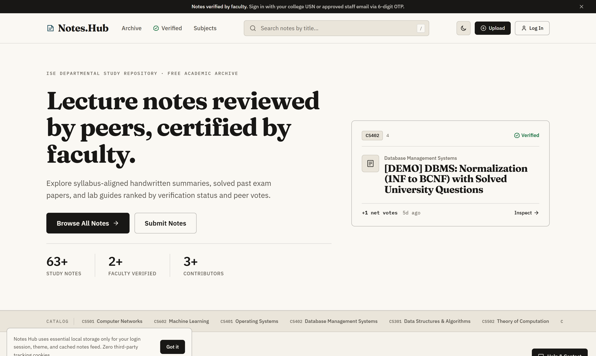
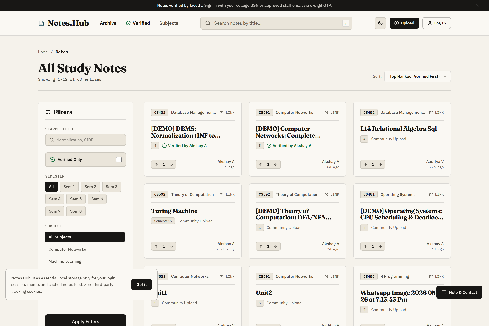
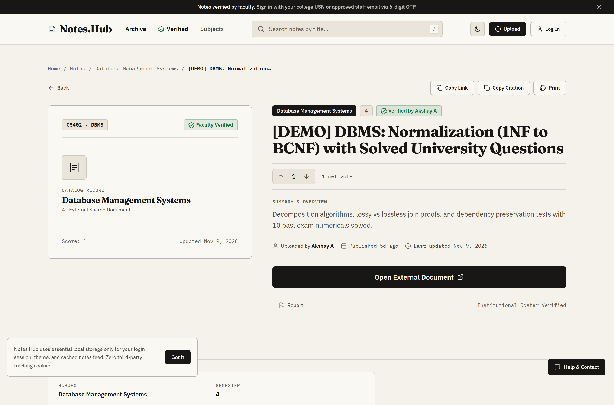
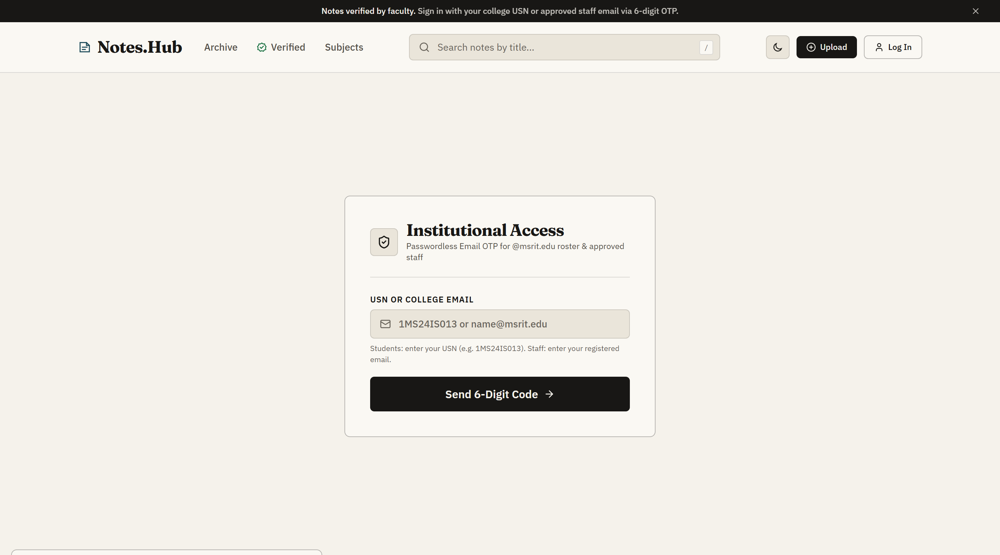
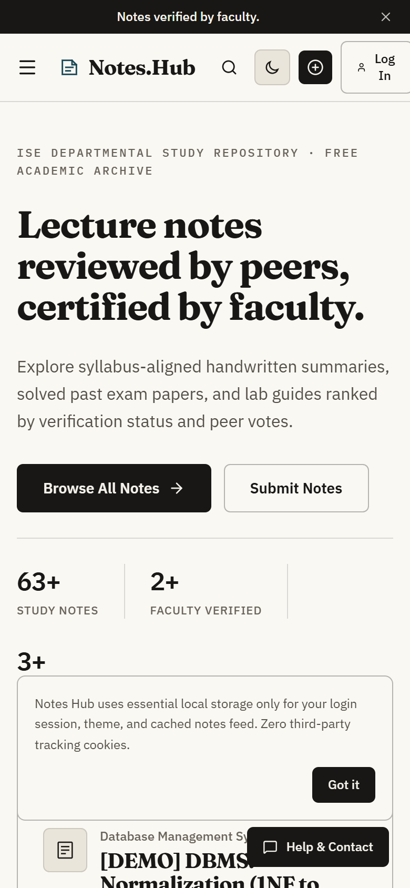
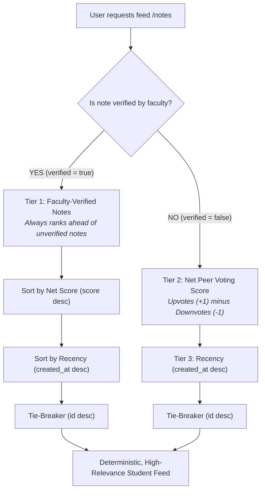
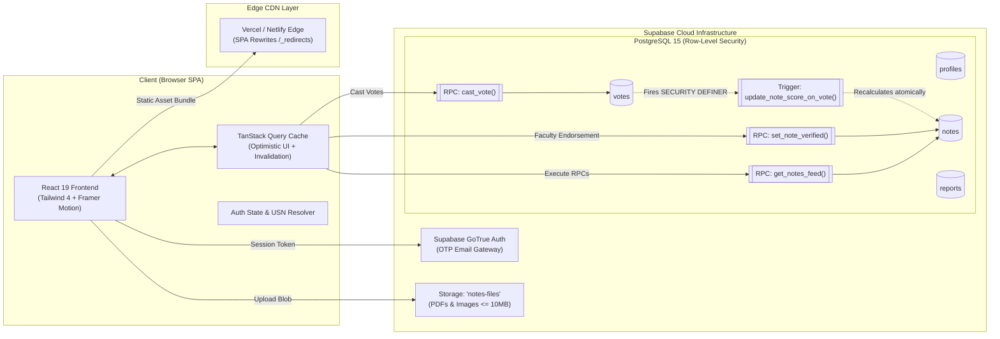
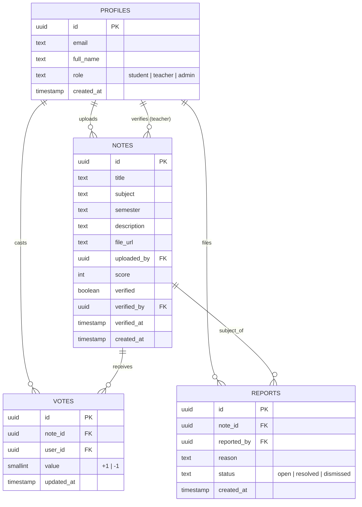

# Notes Hub 📚
### Academic Notes Platform with Peer Voting & Faculty Verification

[](https://react.dev)
[](https://vite.dev)
[](https://tailwindcss.com)
[](https://tanstack.com/query)
[](https://supabase.com)
[](https://vitest.dev)
[](https://vercel.com)
[](https://opensource.org/licenses/MIT)

---

## 📑 Table of Contents
- [1. Visual Showcase](#1-visual-showcase)
- [2. Problem Statement](#2-problem-statement)
- [3. The Solution & Ranking Paradigm](#3-the-solution--ranking-paradigm)
- [4. Platform Architecture & Data Flow](#4-platform-architecture--data-flow)
- [5. Core Feature Matrix](#5-core-feature-matrix)
- [6. Technology Stack](#6-technology-stack)
- [7. Institutional Access & Authentication (OTP Roster)](#7-institutional-access--authentication-otp-roster)
- [8. Bulk Ingestion Pipeline & Storage Engine](#8-bulk-ingestion-pipeline--storage-engine)
- [9. Database Schema & Security (RLS)](#9-database-schema--security-rls)
- [10. Project Structure](#10-project-structure)
- [11. Local Setup & Installation Guide](#11-local-setup--installation-guide)
- [12. Automated Testing & Code Quality](#12-automated-testing--code-quality)
- [13. Presentation & Pitch Deck Script](#13-presentation--pitch-deck-script)
- [14. Production Deployment & Keep-Alive](#14-production-deployment--keep-alive)
- [15. License](#15-license)

---

## 1. Visual Showcase

### 🖥️ Editorial Landing & Dynamic Statistics
> Modern editorial typography featuring live aggregated counts (`{n}+ Notes`, `{n}+ Verified`, `{n}+ Students`), subject ticker marquee, and top-ranking study materials.



---

### 🔍 Explore Catalog & Dynamic Filters
> Filter by semester (Sem 1 to Sem 8), department subjects, or "Faculty Verified Only". Synchronized with URL query parameters for instant bookmarking and sharing.



---

### 📄 Note Detail & Faculty Audit Trail
> High-contrast note viewer featuring PDF preview, one-click citation generator (`IEEE / Harvard format`), direct attachment download, and verified faculty timestamp.



---

### 🔐 Passwordless Institutional Authentication
> Restricted strictly to institutional emails (`@msrit.edu`) and recognized USNs with passwordless 6-digit email OTP codes.

<p align="center">
  
</p>

---

### 📱 Responsive Mobile Experience
> First-class mobile viewport support featuring touch-friendly drawer filters, pill navigation, and condensed card layouts.

<p align="center">
  
</p>

---

## 2. Problem Statement

In academic institutions, lecture summaries, lab manuals, and exam preparation guides are fragmented across informal WhatsApp group chats, Discord servers, and unorganized Google Drive folders:
- **Zero Quality Control**: High-stakes revision guides often contain calculation errors, omitted proofs, or outdated syllabus topics without any feedback mechanism.
- **Revision Bottlenecks**: Students spend hours sifting through duplicate or incomplete PDFs instead of focusing on verified course concepts.
- **Faculty Disconnect**: Professors lack a direct, low-friction channel to endorse exceptional student work or correct misleading materials circulating before exams.

---

## 3. The Solution & Ranking Paradigm

**Notes Hub** centralizes course materials into an open, community-curated repository backed by an authoritative **3-Tier Ranking Engine**. 



> **The Verification Invariant**: Faculty verification always supersedes community popularity. A verified study guide with 2 votes will consistently rank above an unverified note with 30 votes, ensuring academic accuracy is prioritized.

---

## 4. Platform Architecture & Data Flow



---

## 5. Core Feature Matrix

| Feature | Student Role | Faculty Role | Implementation Details |
|---|:---:|:---:|---|
| **Institutional Login** | ✅ | ✅ | USN fast-lookup (`1MS24IS...`) + 6-digit email OTP |
| **Direct PDF Uploads** | ✅ | ✅ | Supabase Storage bucket with 10 MB per-file quota |
| **External Drive Links** | ✅ | ✅ | Validated Google Drive / OneDrive shared links |
| **Upvote / Downvote** | ✅ | ✅ | Atomic PostgreSQL RPC; self-voting strictly barred |
| **Faculty Verification** | ❌ | ✅ | Green badge with verifier name & audit timestamp |
| **Review Queue (`/review`)** | ❌ | ✅ | Flags negative-score notes (`score <= -3`) & reported items |
| **Peer Flagging & Reports** | ✅ | ✅ | Community reporting modal with structured reasons |
| **Citation Generator** | ✅ | ✅ | Instant IEEE, Harvard, and BibTeX citation formatting |
| **Subject Marquee** | ✅ | ✅ | Animated marquee paused on hover / reduced motion |
| **Theme Customization** | ✅ | ✅ | High-contrast Light Mode and Dark Mode support |

---

## 6. Technology Stack

- **Frontend Core**: [React 19](https://react.dev) + [Vite 8](https://vite.dev) (ESM-native Rolldown pipeline)
- **State & Server Cache**: [TanStack Query v5](https://tanstack.com/query) with optimistic updates and background refetching
- **Styling**: [Tailwind CSS 4](https://tailwindcss.com) + custom monochrome design tokens
- **Typography**: [Archivo Variable](https://fontsource.org) (display uppercase) and [Inter Variable](https://fontsource.org) (body)
- **Backend & Database**: [Supabase](https://supabase.com) (PostgreSQL 15 with Row-Level Security)
- **File Storage**: Supabase Storage (`notes-files` bucket with sanitization)
- **Headless Document Engine**: [Puppeteer Core](https://pptr.dev) for automated local HTML-to-PDF conversion
- **Testing**: [Vitest](https://vitest.dev) (23 pure domain & ranking unit tests)
- **Linting & Code Quality**: [Oxlint](https://oxc.rs) (high-speed AST-based linter, 0 errors / 0 warnings)

---

## 7. Institutional Access & Authentication (OTP Roster)

Authentication is safeguarded by a two-stage institutional verification mechanism:

1. **Department Roster Whitelist**:
   - The database contains a pre-approved roster (`supabase/roster.sql`) of enrolled USNs and faculty email addresses.
   - Entering a USN (e.g. `1MS24IS013`) automatically resolves to `1ms24is013@msrit.edu`.
2. **6-Digit Passwordless Email OTP**:
   - Supabase GoTrue generates a secure, one-time passcode delivered directly to the user's `@msrit.edu` inbox.
   - Built-in 60-second cooldown timer prevents rate-limiting abuse.
3. **Database RLS Invariant**:
   - A PostgreSQL trigger on `auth.users` automatically provisions the corresponding record in `public.profiles` and enforces domain restrictions at the engine level.

---

## 8. Bulk Ingestion Pipeline & Storage Engine

Notes Hub includes a dedicated ingestion script (`scripts/import-notes.mjs`) designed for semester-wide repository population:

```
[Local Semester Archives] (A:\SEM 5 & A:\SEM4_Complete)
           │
           ▼
[Deduplication & Format Filter] (Extracts PDFs, JPGs, PNGs, and HTML)
           │
     ┌─────┴────────────────────────────────┐
     │                                      │
[Direct Asset]                     [HTML Lecture Book]
(PDF / Image <= 10MB)             (Render via headless browser)
     │                                      │
     │                             [Converted A4 PDF]
     │                                      │
     └──────────────┬───────────────────────┘
                    ▼
     [Quota Balancer (50/50 Split)]
     (Alternates between student uploaders)
                    ▼
     [Supabase Storage: notes-files]
                    ▼
     [public.notes Table Insert]
                    ▼
     [.import-manifest.json Idempotency Cache]
```

### Key Capabilities:
- **Read-Only Source Guarantee**: Scans local source folders without modifying, moving, or deleting source files.
- **Headless HTML-to-PDF Conversion**: Automatically launches local Brave/Chrome via `puppeteer-core` to render interactive HTML guides into printable A4 PDFs with background graphics enabled.
- **SHA-256 Deduplication**: Calculates file hashes to eliminate redundant uploads.
- **Resilient Manifest Tracking**: Records every imported document in `scripts/.import-manifest.json` for 100% idempotent re-runs.

---

## 9. Database Schema & Security (RLS)

The database schema is strictly enforced through PostgreSQL **Row Level Security (RLS)**:



### Security Highlights:
- **Tamper-Proof Voting Trigger**: Scores are maintained via a `SECURITY DEFINER` function triggered on `AFTER INSERT OR UPDATE OR DELETE ON public.votes`. Direct updates to `notes.score` by client tokens are rejected.
- **Self-Voting Prohibition**: Database check constraints ensure students cannot cast upvotes or downvotes on their own uploads.
- **Teacher-Only Verification**: Only users with `role = 'teacher'` in `public.profiles` are permitted to execute `set_note_verified()`.

---

## 10. Project Structure

```
├── .github/
│   └── workflows/
│       └── keep-alive.yml         # GitHub Actions cron ping (prevents Supabase pause)
├── docs/
│   └── screenshots/               # High-res UI documentation assets
├── public/
│   ├── _redirects                 # Netlify SPA routing fallback
│   ├── favicon.svg                # Modern monochrome SVG favicon
│   └── icons.svg                  # SVG symbol sprite
├── scripts/
│   ├── import-notes.mjs           # Multi-semester bulk import & conversion engine
│   ├── capture-screenshots.mjs    # Automated headless UI screenshot generator
│   └── build-roster.mjs           # Department USN roster migration compiler
├── src/
│   ├── components/                # Modular UI components
│   │   ├── ui/                    # Reusable primitives (Button, Pill, StatBlock, Marquee)
│   │   ├── Navbar.jsx             # Navigation header with search and theme toggle
│   │   ├── NoteCard.jsx           # Study material card with score pill & verified seal
│   │   ├── HeroIllustration.jsx   # SVG tilted note-card stack graphic
│   │   └── Footer.jsx             # Monochrome footer with department quick-links
│   ├── context/
│   │   ├── AuthContext.jsx        # Institutional authentication provider
│   │   └── ToastContext.jsx       # Global notification dispatch system
│   ├── lib/
│   │   ├── constants.js           # Course subjects, metadata, codes, and colors
│   │   ├── notesApi.js            # Supabase RPC abstraction layer
│   │   ├── queryClient.js         # TanStack Query client & cache helpers
│   │   └── supabaseClient.js      # Supabase JavaScript client
│   ├── pages/
│   │   ├── Home.jsx               # Editorial landing with stats & curated rows
│   │   ├── Notes.jsx              # Searchable, filterable course catalog
│   │   ├── NoteDetail.jsx         # Detail view with PDF preview & citation generator
│   │   ├── Login.jsx              # USN lookup and 6-digit email OTP modal
│   │   ├── Upload.jsx             # File attachment & Google Drive submit form
│   │   ├── Review.jsx             # Faculty moderation & report resolution queue
│   │   └── Admin.jsx              # Roster management dashboard
│   ├── test/
│   │   └── pureLogic.test.js      # Vitest unit test suite (23 tests)
│   ├── App.jsx                    # Route hierarchy & React Router configuration
│   └── index.css                  # Tailwind CSS 4 theme tokens
├── supabase/
│   ├── schema.sql                 # Base tables and indexes
│   ├── phase2.sql                 # Email domain trigger
│   ├── phase4.sql                 # Atomic voting triggers & cast_vote RPC
│   ├── phase5.sql                 # Faculty verification procedures
│   ├── phase8.sql                 # Multi-filter get_notes_feed RPC
│   ├── phase9_auth.sql            # USN roster schema & OTP security policies
│   └── roster.sql                 # 73-student ISE department roster seed
├── vercel.json                    # Vercel SPA routing rewrite
└── vite.config.js                 # Vite bundler configuration & code splitting
```

---

## 11. Local Setup & Installation Guide

### Prerequisites
- [Node.js](https://nodejs.org) v20 or higher
- [Git](https://git-scm.com)
- A free [Supabase](https://supabase.com) account

### Step 1: Clone Repository
```bash
git clone https://github.com/AnanthAkshay/notes-hub.git
cd notes-hub
npm install
```

### Step 2: Configure Environment Variables
Create a `.env` file in the project root:
```env
VITE_SUPABASE_URL=https://your-project.supabase.co
VITE_SUPABASE_ANON_KEY=your-supabase-anon-key
VITE_ALLOWED_EMAIL_DOMAIN=msrit.edu
```

### Step 3: Run Database Migrations
In your Supabase project's **SQL Editor**, execute the migration scripts located in `supabase/` in the following sequence:
1. `supabase/schema.sql` (Tables, constraints, base indexes)
2. `supabase/phase2.sql` (Domain restriction trigger)
3. `supabase/phase3.sql` (Storage bucket creation & RLS)
4. `supabase/phase4.sql` (Voting triggers & `cast_vote` RPC)
5. `supabase/phase5.sql` (Teacher verification functions)
6. `supabase/phase6.sql` (Composite performance indexes)
7. `supabase/phase7.sql` (Moderation & reporting queue)
8. `supabase/phase8.sql` (Feed RPC `get_notes_feed`)
9. `supabase/phase9_auth.sql` (Roster authentication tables)
10. `supabase/roster.sql` (Department student & faculty roster)

*(Optional) To populate realistic sample notes across multiple semesters, run `supabase/seed-demo.sql`.*

### Step 4: Start Development Server
```bash
npm run dev
```
Open [http://localhost:5173](http://localhost:5173) in your browser.

---

## 12. Automated Testing & Code Quality

### Running Unit Tests
Unit tests validate pure business logic, ranking calculations, citation generators, and title sanitization:
```bash
npm test
```
```
 ✓ src/test/pureLogic.test.js (23 tests) 32ms
 Test Files  1 passed (1)
      Tests  23 passed (23)
```

### Running Static Analysis
Linting is powered by [Oxlint](https://oxc.rs) to ensure strict syntax hygiene:
```bash
npm run lint
```
```
Found 0 warnings and 0 errors.
Finished on 59 files using 22 threads.
```

---

## 13. Presentation & Pitch Deck Script

### 🎙️ 3-Minute Live Demo Script

| Timing | Screen | Spoken Walkthrough |
|---|---|---|
| **0:00 - 0:40** | **Home (`/`)** | *"Notes Hub replaces chaotic WhatsApp drives with an authoritative, college-verified academic portal. Here you can see live stats, trending course summaries, and our dynamic marquee."* |
| **0:40 - 1:20** | **Explore (`/notes`)** | *"Notice our 3-tier ranking engine. Unverified notes compete through peer upvotes and downvotes, but faculty-verified guides always claim top ranking. When a professor verifies a note, it instantly supersedes peer popularity."* |
| **1:20 - 2:00** | **Note Detail (`/notes/:id`)** | *"Each note features an embedded PDF preview, institutional verification timestamps, and an automated IEEE citation generator for academic papers."* |
| **2:00 - 2:40** | **Review Queue (`/review`)** | *"Faculty members have a dedicated review portal. They can inspect student uploads, verify accuracy with one click, or review materials flagged by the community."* |
| **2:40 - 3:00** | **Architecture & Cost** | *"The entire system operates on zero infrastructure costs—leveraging Supabase PostgreSQL RLS and Vercel Edge CDN."* |

---

## 14. Production Deployment & Keep-Alive

### Deploying to Vercel / Netlify
1. Connect your GitHub repository to Vercel or Netlify.
2. Set the Build Command to `npm run build` and Output Directory to `dist`.
3. Add environment variables:
   - `VITE_SUPABASE_URL`
   - `VITE_SUPABASE_ANON_KEY`
   - `VITE_ALLOWED_EMAIL_DOMAIN`
4. Deploy. Both `vercel.json` and `public/_redirects` are pre-configured for Single-Page Application (SPA) routing.

### Automated Keep-Alive Workflow
Free-tier Supabase instances pause after 7 days of inactivity. Notes Hub includes an automated GitHub Action ([`.github/workflows/keep-alive.yml`](.github/workflows/keep-alive.yml)) that pings the Supabase REST endpoint on a scheduled cron schedule to keep the database warm and responsive:

```yaml
name: Supabase Keep-Alive Ping
on:
  schedule:
    - cron: '0 6 */3 * *' # Every 3 days at 06:00 UTC
  workflow_dispatch:
```

---

## 15. License

Distributed under the **MIT License**. See `LICENSE` for details.

Developed for students and faculty of the **Information Science & Engineering Department**.
Contributions and issue reports are welcome via pull requests!
